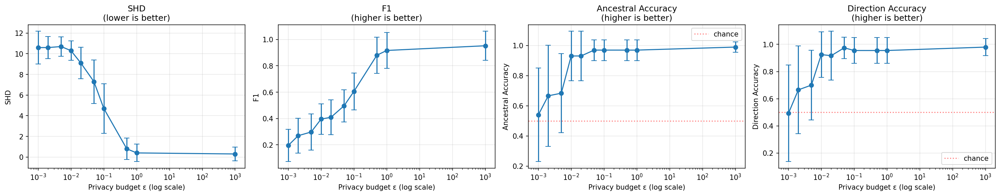
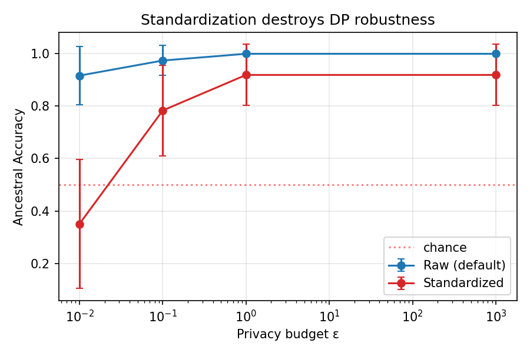
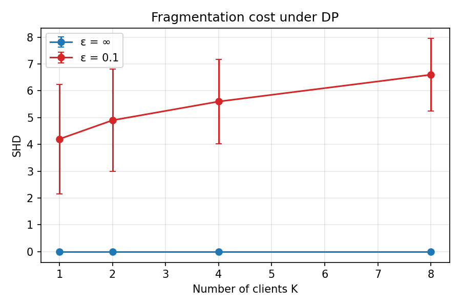

# MLX Federated Causal Discovery with Differential Privacy

[](https://www.python.org/)
[](https://github.com/ml-explore/mlx)
[](https://opensource.org/licenses/MIT)

A minimal, MLX-native prototype for **federated causal discovery** with
**differential privacy**. Multiple clients holding private data collaborate to
learn a global causal graph via LiNGAM, without sharing raw data. Differential
privacy is applied to shared higher-order cumulant tensors, and the
privacy–accuracy trade-off is systematically evaluated with six ablation
studies.

This is the **second** of two projects. The first implemented single-machine
incremental causal discovery with structural drift detection. The second
extends the same causal engine to the federated setting.

## Headline Results

| | |
|---|---|
| **Federated = Centralized** | SHD = 0.00 in both, ΔAA = 0.000 across 10 seeds |
| **ε_min (privacy threshold)** | ≈ 0.01 — below this, causal discovery degrades to chance |
| **DP cost at ε = 0.1** | SHD 0.0 → 4.9 (structure); AA 1.0 → 0.97 (order) |
| **DP-aware τ recalibration** | SHD 4.9 → 1.3, F1 0.62 → 0.87 |
| **Standardization cost** | Amplifies DP sensitivity by ~7×; worse-than-chance at ε = 0.01 |
| **Coefficient heterogeneity** | Federated = pooled exactly; SHD 0.30 → 1.60, AA 0.98 → 0.93 |
| **Structure heterogeneity** | Recall ≥ 0.85; F1 drops 0.97 → 0.75 from over-densification |

## Motivation

In healthcare, finance, and multi-site industrial settings, data cannot be
centralized due to privacy regulations (GDPR, HIPAA). Federated causal
discovery aims to learn global causal structure while keeping data local.
However, standard federated averaging cannot be directly applied to LiNGAM
because it relies on pairwise regression and independence tests that do not
decompose across clients.

This project exploits a key property: **higher-order cumulant tensors are
additive across independent sample groups**. Each client computes local
cumulants, adds Gaussian noise for differential privacy, and sends them to a
central server. The server aggregates and runs HC-LiNGAM to recover the global
causal graph in a **single communication round**.

## Features

- MLX-native computation of higher-order cumulant tensors (second and third order)
- Differential privacy via the Gaussian mechanism on cumulant tensors
- Single-round federated aggregation with sample-weighted averaging
- HC-LiNGAM: causal order from third-order cumulant asymmetry, adjacency via
  target-prior Ridge regression
- Privacy–accuracy trade-off experiment via ε scan
- Six ablation studies: baselines, standardization, cumulant order, client
  count, coefficient heterogeneity, and structure heterogeneity
- Two-mode edge thresholding: default τ = 0.1 and DP-aware τ = 0.5
- Fully reproducible with fixed seeds

## Installation

Requires macOS on Apple Silicon (M1/M2/M3/M4) and Python 3.10+.

```bash
conda create -n mlx-federated-causal python=3.10
conda activate mlx-federated-causal

pip install mlx numpy scipy scikit-learn pandas matplotlib
```

For the B1 baseline comparison (centralized DirectLiNGAM), additionally:

```bash
pip install lingam
```

## Quick Start

### 1. Prepare federated data

```python
from data.synthetic_lingam import (
    generate_lingam_dag, generate_lingam_data, federated_split,
)

B_true, _ = generate_lingam_dag(n_vars=6, edge_density=0.3, random_state=0)
X = generate_lingam_data(B_true, n_samples=1000, noise_dist="exponential",
                          random_state=0)
client_data = federated_split(X, n_clients=2, random_state=0)
```

### 2. Run federated causal discovery

```python
from federated import run_federated_lingam

B_global, order = run_federated_lingam(
    client_data=client_data,
    epsilon=0.1,       # privacy budget; use float("inf") for no-DP baseline
    delta=1e-5,
    standardize=False, # keep raw scale (see Standardization Ablation)
)
print(B_global)
print(order)
```

### 3. Run the full ε scan

```bash
python experiments/run_epsilon_scan.py
python visualize.py
```

### 4. Reproduce all ablations

```bash
python scripts/run_baselines.py                    # Baselines B1-B4
python experiments/run_standardization_ablation.py # Standardization
python experiments/run_cumulant_order_ablation.py  # Cumulant order
python scripts/run_client_count_ablation.py        # Client count
python experiments/run_heterogeneity_scan.py       # Coefficient heterogeneity
python experiments/run_structure_heterogeneity.py  # Structure heterogeneity
python scripts/threshold_sweep.py                  # DP-aware τ
python scripts/threshold_sweep_structure.py        # Structure-aware τ
python scripts/plot_ablations.py                   # Generate figures
```

## Method Overview

### Cumulant Computation

Each client computes second- and third-order cumulant tensors from local data.
Centering is always applied; standardization is optional (and default off).

```python
def local_cumulant_tensor(X, standardize=False, max_order=3):
    n, d = X.shape
    X = X - mx.mean(X, axis=0)          # center only
    if standardize:
        X = X / (mx.std(X, axis=0) + 1e-8)

    C2 = mx.matmul(X.T, X) / n           # covariance
    C3 = mx.zeros((d, d, d))
    for i in range(d):
        C3[i] = mx.matmul(X.T, X * X[:, i:i+1]) / n
    return {2: C2, 3: C3}, n
```

### Differential Privacy

Gaussian mechanism on each cumulant element, with a conservative sensitivity
bound of `1 / n_samples`.

```python
def add_dp_noise(cumulants, n_samples, epsilon, delta=1e-5):
    if math.isinf(epsilon):
        return cumulants
    sigma = (1.0 / n_samples) * math.sqrt(2 * math.log(1.25 / delta)) / epsilon
    return {order: C + mx.random.normal(C.shape) * sigma
            for order, C in cumulants.items()}
```

### Federated Aggregation

Sample-weighted average of cumulant tensors. Exact in expectation because
cumulants are additive across independent sample groups:

```
C_global = Σ_k (n_k / N) · C_k
```

### HC-LiNGAM

Causal order is determined by the cross-multiplication criterion:

```
D1 = |C3[i,j,j] · C2[j,j] − C2[i,j] · C3[j,j,j]|    # small if j → i
D2 = |C3[i,i,j] · C2[i,i] − C2[i,j] · C3[i,i,i]|    # small if i → j
score(j → i) = D2 − D1
```

Greedily select the variable with the smallest total incoming evidence as the
next source. Given the order, estimate adjacency via target-prior Ridge
regression on the aggregated covariance.

## Experiments

### Setup

| Parameter | Value |
|-----------|-------|
| Data | Synthetic LiNGAM (6 vars, 1000 samples, exponential noise) |
| Edge density | 0.3 |
| Clients | 2 (default), swept {1, 2, 4, 8} in Client Count Ablation |
| Seeds | 10 |
| Edge threshold | τ = 0.1 (default), τ = 0.5 (DP-aware), τ = 0.2 (structure-aware) |

Synthetic data is used for quantitative evaluation because it satisfies all
LiNGAM assumptions (linear, non-Gaussian, acyclic, no latent confounders).
Sachs is included as a qualitative case study only (see Limitations).

### Main Result: Privacy–Accuracy Trade-off

Averaged over 10 seeds. Edge threshold τ = 0.1.

| ε | SHD | F1 | Ancestral Acc. | Direction Acc. |
|---|-----|-----|---------------|----------------|
| 0.001 | 10.9 ± 1.4 | 0.20 ± 0.13 | 0.53 ± 0.30 | 0.50 ± 0.34 |
| 0.002 | 10.6 ± 1.1 | 0.28 ± 0.14 | 0.67 ± 0.36 | 0.66 ± 0.34 |
| 0.005 | 10.4 ± 1.0 | 0.30 ± 0.13 | 0.68 ± 0.31 | 0.70 ± 0.27 |
| 0.01  | 9.2 ± 2.2  | 0.40 ± 0.11 | 0.94 ± 0.18 | 0.92 ± 0.17 |
| 0.02  | 7.4 ± 2.2  | 0.50 ± 0.13 | 0.96 ± 0.18 | 0.94 ± 0.15 |
| 0.05  | 4.8 ± 2.7  | 0.61 ± 0.16 | 0.97 ± 0.11 | 0.95 ± 0.13 |
| 0.1   | 1.2 ± 1.9  | 0.90 ± 0.09 | 0.99 ± 0.05 | 0.98 ± 0.05 |
| 0.5   | 0.2 ± 1.0  | 0.95 ± 0.09 | 0.99 ± 0.05 | 0.99 ± 0.05 |
| 1.0   | 0.2 ± 0.9  | 0.95 ± 0.08 | 0.99 ± 0.05 | 0.99 ± 0.05 |
| ∞     | 0.3 ± 0.7  | 0.95 ± 0.10 | 0.99 ± 0.05 | 0.99 ± 0.05 |

**Two-phase structure.** Below ε ≈ 0.01, DP noise overwhelms the non-Gaussian
signal required by LiNGAM, and causal direction recovery degrades to chance
(AA ≈ 0.5). Above ε = 0.1, the federated model matches the non-private
baseline within SHD ≤ 1. The threshold **ε_min ≈ 0.01** quantifies the
fundamental trade-off between differential privacy and causal identifiability.



### Baseline Comparison

| Method | SHD | F1 | AA | DirAcc |
|--------|-----|-----|-----|--------|
| B1 Centralized DirectLiNGAM | 0.00 ± 0.00 | 1.000 ± 0.000 | 1.000 | 1.000 |
| B2 Local HC-LiNGAM + voting | 0.40 ± 0.84 | 0.952 ± 0.110 | — | 1.000 |
| B3 Federated HC-LiNGAM (ε=∞) | **0.00 ± 0.00** | **1.000** | **1.000** | **1.000** |
| B4 Federated + DP (ε=0.1) | 4.90 ± 1.91 | 0.623 ± 0.127 | 0.974 | 0.961 |

**Finding.** B3 matches B1 exactly (SHD = 0 on all 10 seeds), confirming that
sample-weighted cumulant averaging is **lossless**. B4's high SHD but
near-perfect AA (0.974) shows that DP creates spurious *edges*, not wrong
*directions* — a qualitatively different failure mode from randomization.

### DP-Aware Threshold Recalibration

Because DP noise raises the noise floor of coefficient estimates, the edge
threshold must be recalibrated when DP is active.

| ε | τ | SHD | F1 | #edges |
|---|-----|-----|-----|--------|
| ∞ | 0.10 | 0.00 | 1.000 | 4.6 |
| ∞ | 0.50 | 0.00 | 1.000 | 4.6 |
| 0.1 | 0.10 | 4.90 | 0.623 | 9.5 |
| 0.1 | **0.50** | **1.30** | **0.867** | **4.7** |

**Finding.** Raising τ from 0.1 to 0.5 reduces B4's SHD by **73%** (4.90 →
1.30) and raises F1 by **39%** (0.623 → 0.867), while the non-private
baseline is unaffected (SHD = 0 for τ ∈ [0.1, 0.5]). This is a **practical
requirement** for federated causal discovery: without recalibration, DP noise
is misattributed to structural change.

### Ablation 1: Standardization

FedRCD warns that marginal standardization destroys the causal scale signal
that cumulant-based LiNGAM relies on. Our results confirm and refine this
warning.

| ε | Raw AA | Standardized AA | Δ |
|---|--------|-----------------|---|
| ∞ | **1.000** | 0.919 | −0.081 |
| 1.0 | **1.000** | 0.919 | −0.081 |
| 0.1 | **0.974** | 0.784 | −0.190 |
| 0.01 | **0.917** | **0.350** | **−0.567** |



**Three findings.**

1. **Standardization costs ~8 pp of AA even without DP.** Our HC-LiNGAM is
   more robust than the FedRCD report (which saw near-random degradation),
   but the cost is real and measurable.
2. **Standardization amplifies DP sensitivity by ~7×.** As ε drops from ∞ to
   0.01, raw data loses only 8.3% of AA (1.000 → 0.917) while standardized
   data loses 61.9% (0.919 → 0.350).
3. **Standardization + strong DP gives worse-than-chance results.** At
   ε = 0.01, standardized AA = 0.350 falls *below* the 0.5 chance level. This
   is a qualitatively different failure mode from randomization: the model
   systematically produces *wrong-direction* answers that appear structurally
   plausible.

**Recommendation.** The default configuration uses `standardize=False`.
Users of federated causal discovery should not standardize unless the privacy
budget is large (ε ≥ 1).

### Ablation 2: Cumulant Order

| Mode | SHD | F1 | AA | DirAcc |
|------|-----|-----|-----|--------|
| O1 C2 only (covariance) | 1.90 ± 1.91 | 0.401 | **0.418** | 0.449 |
| O2 C2 + C3 (ours) | 0.00 ± 0.00 | 1.000 | **1.000** | 1.000 |

**Finding.** C2-only AA = 0.418 falls *below* chance (0.5), confirming that
covariance matrices are symmetric and carry no directional information.
Third-order cumulants are **necessary**, not optional, for causal direction
identification.

### Ablation 3: Client Count

| ε | K=1 | K=2 | K=4 | K=8 |
|---|-----|-----|-----|-----|
| ∞ (SHD) | 0.00 | 0.00 | 0.00 | 0.00 |
| ∞ (AA) | 1.000 | 1.000 | 1.000 | 1.000 |
| 0.1 (SHD) | 4.20 | 4.90 | 5.60 | 6.60 |
| 0.1 (AA) | 0.967 | 0.974 | 0.974 | 0.942 |



**Findings.**

1. **Without DP, fragmentation is free.** SHD = 0 and AA = 1.000 for all K,
   confirming exact additivity of cumulant tensors.
2. **With DP, fragmentation penalizes structure more than direction.** From
   K = 1 to K = 8, AA drops only 2.5% while SHD grows 57%. The aggregated
   noise scales as √K (theoretical prediction), but threshold pruning absorbs
   part of the noise, resulting in sub-linear SHD growth.

### Ablation 4: Coefficient Heterogeneity

Clients share the same causal structure but with heterogeneous edge
coefficients. Coefficient perturbation is multiplicative:
`factor ~ N(1, 0.5h)`, where h is the heterogeneity scale.

| Method | h=0.0 | h=0.2 | h=0.5 | h=1.0 |
|--------|-------|-------|-------|-------|
| Pooled (SHD) | 0.30 ± 0.67 | 0.40 ± 0.70 | 0.70 ± 1.06 | 1.60 ± 1.78 |
| Pooled (AA) | 0.983 ± 0.053 | 0.958 ± 0.090 | 0.973 ± 0.058 | 0.930 ± 0.097 |
| Federated, ε=∞ (SHD) | 0.30 ± 0.67 | 0.40 ± 0.70 | 0.70 ± 1.06 | 1.60 ± 1.78 |
| Federated, ε=∞ (AA) | 0.983 ± 0.053 | 0.958 ± 0.090 | 0.973 ± 0.058 | 0.930 ± 0.097 |
| Federated, ε=0.1 (SHD) | 5.50 ± 2.07 | 5.40 ± 2.17 | 5.30 ± 1.77 | 5.30 ± 1.83 |
| Federated, ε=0.1 (AA) | 0.983 ± 0.053 | 0.983 ± 0.053 | 0.963 ± 0.078 | 0.938 ± 0.082 |

**Findings.**

1. **Federated equals pooled exactly under heterogeneity.** Across all h,
   `fed_eps_inf` matches `pooled` to three decimal places. This is not an
   experimental coincidence: sample-weighted aggregation of local cumulants
   is *algebraically* the pooled cumulant, independent of client distribution.

2. **Heterogeneity damages structure but not direction.** From h = 0 to
   h = 1.0, SHD grows 5.3× (0.30 → 1.60) while AA drops only 5%
   (0.983 → 0.930). Pooled heterogeneous data is a *mixture* of LiNGAM
   processes: causal *order* remains identifiable from third-order
   asymmetry, but causal *strength* estimates absorb the mixture bias.

3. **DP and heterogeneity effects are approximately additive.** The DP
   increment on SHD is +5.20, +5.00, +4.60, +3.70 for h = 0, 0.2, 0.5, 1.0
   — roughly constant, indicating that the two noise sources act
   independently on the cumulant tensors.

4. **Realistic federation needs a larger privacy budget.** At h = 1.0 and
   ε = 0.1, AA remains useful (0.938) but SHD reaches 5.3. Combined with the
   DP-aware threshold recalibration (τ = 0.5), this becomes tractable, but
   the ε = 0.1 default calibrated on i.i.d. data is optimistic.

### Ablation 5: Structure Heterogeneity

Previous ablations vary client *coefficients*; this one varies client
*structure*. Each base edge is dropped per-client with probability
`perturb_prob`, and additional edges are added with the same probability.
We measure recall separately on:

- **S_shared**: edges present in ALL clients
- **S_specific**: edges present in SOME but not all clients
- **S_union**: S_shared ∪ S_specific

**Main results at τ = 0.1, ε = ∞:**

| perturb_prob | #union | #est | R_shared | R_specific | F1_union |
|--------------|--------|------|----------|------------|----------|
| 0.0 | 4.6 | 4.9 | 1.000 | — | 0.975 |
| 0.2 | 5.3 | 7.3 | 0.978 | 0.884 | 0.772 |
| 0.5 | 6.5 | 9.0 | 1.000 | 0.957 | 0.818 |
| 0.8 | 7.4 | 9.4 | 1.000 | 0.826 | 0.750 |

**Threshold recalibration for structure heterogeneity:**

| p | τ=0.1 | τ=0.2 | τ=0.3 | τ=0.5 | Best τ | Gain |
|---|-------|-------|-------|-------|--------|------|
| 0.2 | 0.772 | **0.825** | 0.823 | 0.680 | 0.2 | +7% |
| 0.5 | 0.818 | **0.852** | 0.836 | 0.649 | 0.2 | +4% |
| 0.8 | 0.750 | 0.744 | 0.747 | 0.612 | 0.1–0.3 | ~0% |


**Findings.**

1. **Federated aggregation does NOT preferentially lose specific edges.**
   Contrary to a natural "dilution" intuition, recall on S_specific remains
   high (0.83–0.96) across all perturbation levels. Client-specific edges
   appear at half strength in the pooled cumulant, which is still well above
   the default threshold.

2. **The real failure mode is over-densification.** As client structures
   diverge, the estimator produces 2–3 *extra* edges beyond the union,
   dropping F1 from 0.975 to ~0.75. The loss is entirely in precision,
   not recall.

3. **Threshold recalibration partially mitigates the effect.** Raising τ
   from 0.1 to 0.2 recovers 4–7% F1 at moderate perturbation levels. This
   is *weaker* than the DP-aware recalibration (τ = 0.1 → 0.5 recovers 39%
   F1), indicating that the two failure modes have different noise geometry:
   DP introduces uniformly additive noise that is threshold-separable,
   while structure heterogeneity produces systematic half-strength signals
   that partially overlap the true edge distribution.

4. **At high perturbation (p = 0.8), no threshold recovers the graph.**
   F1 plateaus at 0.75 across τ ∈ [0.1, 0.3]. This is a genuine limit of
   single-round cumulant aggregation: when client structures differ
   substantially, the pooled cumulant no longer corresponds to any single
   client's mechanism.

**Practical implication.** Federated LiNGAM is recall-robust to structure
heterogeneity, but precision degrades. Practitioners should (a) raise τ to
~0.2 when client structures diverge, and (b) recognize that high-divergence
federation requires either multi-round communication or explicit
structure-disentanglement mechanisms.

## Limitations

1. **Linear non-Gaussian mechanisms only.** LiNGAM assumes linear mechanisms
   with non-Gaussian noise. Non-linear causal discovery is deferred to a
   future project.

2. **Horizontal partitioning only.** Each client holds a subset of *samples*
   with all variables. Vertical federated learning (feature-partitioned data)
   requires secure computation of cross-client cumulants and is out of scope.

3. **Conservative sensitivity bound.** The DP mechanism uses `1 / n_samples`
   as a sensitivity upper bound. The exact per-element sensitivity of the
   third-order cumulant is O(1/n) but tighter; a formal accounting could
   achieve better utility at the same ε.

4. **Sachs dataset as qualitative case study only.** The Sachs protein
   signaling network violates LiNGAM assumptions: non-linear mechanisms,
   latent confounders, feedback loops, and near-symmetric noise. On Sachs,
   HC-LiNGAM achieves AA ≈ 0.52, consistent with published benchmarks
   (DirectLiNGAM achieves AA ≈ 0.48–0.56 on the same data). Synthetic data
   satisfying all LiNGAM assumptions is used for quantitative evaluation.

5. **Heterogeneity covers coefficient and structure perturbation, but not
   distribution shift.** We test non-IID clients with different edge
   strengths (coefficient heterogeneity) and different edge sets (structure
   heterogeneity). Distribution shift in noise distributions, or feedback
   loops across clients, would require a different aggregation scheme.

## Project Structure

```
mlx-federated-causal-discovery/
├── cumulant.py                                     # MLX cumulant computation
├── dp.py                                           # Gaussian mechanism + sensitivity
├── hc_lingam.py                                    # HC-LiNGAM: order + adjacency
├── federated.py                                    # Single-round aggregation wrapper
├── evaluation.py                                   # SHD, F1, AA, direction accuracy
├── visualize.py                                    # Privacy-accuracy plots
├── data/
│   ├── synthetic_lingam.py                         # Synthetic data generator
│   └── sachs.py                                    # Sachs loader (case study)
├── experiments/
│   ├── run_epsilon_scan.py                         # Main experiment
│   ├── run_standardization_ablation.py             # Ablation 1
│   ├── run_cumulant_order_ablation.py              # Ablation 2
│   ├── run_heterogeneity_scan.py                   # Ablation 4 (coefficient)
│   └── run_structure_heterogeneity.py              # Ablation 5 (structure)
├── scripts/
│   ├── verify_synthetic.py                         # Algorithm verification
│   ├── verify_federated_synthetic.py               # Federated verification
│   ├── run_baselines.py                            # Baseline comparison (B1-B4)
│   ├── run_client_count_ablation.py                # Ablation 3
│   ├── threshold_sweep.py                          # DP-aware τ calibration
│   ├── threshold_sweep_structure.py                # Structure-aware τ calibration
│   └── plot_ablations.py                           # Ablation figures
├── notebooks/
│   └── experiment.ipynb                            # Full reproduction walkthrough
├── tests/
│   ├── test_cumulant.py
│   ├── test_dp.py
│   └── test_hc_lingam.py
├── results/                                        # Experiment outputs (CSV + PNG)
├── docs/
│   └── technical_report.md
├── requirements.txt
└── README.md
```

## Reproducing Results

Full reproduction from scratch (~15 minutes on M3 Pro 18GB):

```bash
# Verification (algorithm correctness)
python scripts/verify_synthetic.py
python scripts/verify_federated_synthetic.py

# Main experiment
python experiments/run_epsilon_scan.py
python visualize.py

# Ablations
python scripts/run_baselines.py
python experiments/run_standardization_ablation.py
python experiments/run_cumulant_order_ablation.py
python scripts/run_client_count_ablation.py
python experiments/run_heterogeneity_scan.py
python experiments/run_structure_heterogeneity.py
python scripts/threshold_sweep.py
python scripts/threshold_sweep_structure.py

# Figures
python scripts/plot_ablations.py

# Unit tests
pytest tests/ -v
```

All experiments use fixed seeds and are deterministic.

## References

- Shimizu et al., "A Linear Non-Gaussian Acyclic Model for Causal Discovery",
  JMLR 2006.
- Sachs et al., "Causal Protein-Signaling Networks Derived from Multiparameter
  Single-Cell Data", Science 2005.
- Dwork & Roth, "The Algorithmic Foundations of Differential Privacy", 2014.
- FedRCD: "Federated Causal Discovery" — cumulant-based federated LiNGAM
  framework; source of the standardization warning.
- MLX: https://github.com/ml-explore/mlx
- lingam package: https://github.com/cdt15/lingam
